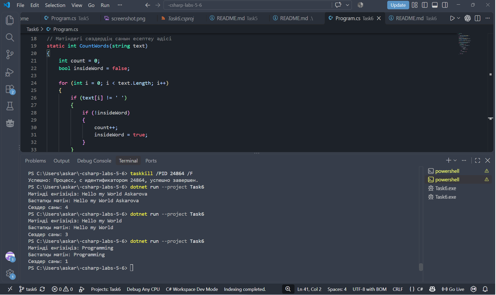

# Task6 — Символдар тіркесі

**Студент:** Аскарова Сарбар  
**Тізімдегі нөмір:** 2  
**Нұсқа:** 1  

## 1. Тапсырманың мақсаты

Берілген мәтіндегі сөздердің санын есептейтін C# бағдарламасын құру.

Сөздер бір немесе бірнеше бос орын арқылы бөлінеді. Мәтіннің басында және соңында бос орындар болуы мүмкін.

## 2. Бағдарламаның жұмыс алгоритмі

1. Пайдаланушыдан мәтін енгізу сұралады.
2. Егер мәтін бос болса, бағдарлама қайтадан мәтін енгізуді сұрайды.
3. Енгізілген бастапқы мәтін экранға шығарылады.
4. `CountWords()` әдісі шақырылады.
5. Мәтіндегі символдар біртіндеп тексеріледі.
6. Егер жаңа сөз басталса, сөз санауышы 1-ге артады.
7. Сөздердің жалпы саны экранға шығарылады.

## 3. Кодты түсіндіру

### 3.1. `text[i]` дегеніміз не және оның типі қандай?

`text[i]` — мәтіндегі индексі `i` болатын символ.

Оның типі — `char`.

Мысалы, `text = "Hello"` болса:

- `text[0]` — H
- `text[1]` — e
- `text[2]` — l
- `text[3]` — l
- `text[4]` — o

### 3.2. C# тіліндегі `string` өзгермейтін тип пе?

Иә, `string` — өзгермейтін (immutable) тип.

Яғни құрылған мәтінді тікелей өзгертуге болмайды. Мәтінді өзгерту қажет болса, жаңа `string` объектісі құрылады.

### 3.3. Сөздің басталғанын қалай анықтаймыз?

Бағдарламада `insideWord` логикалық айнымалысы қолданылады.

- Егер символ бос орын болмаса және `insideWord == false` болса, жаңа сөз басталды деп есептеледі.
- Санауыш 1-ге артады.
- `insideWord = true` болады.
- Егер бос орын кездессе, `insideWord = false` болады.

Осы алгоритм бірнеше бос орынды, мәтіннің басындағы және соңындағы бос орындарды дұрыс өңдейді.

### 3.4. `do-while` циклі қалай жұмыс істейді?

`do-while` циклі алдымен командаларды орындайды, содан кейін шартты тексереді.

Бұл бағдарламада пайдаланушы бос мәтін енгізсе, мәтінді қайта енгізу сұралады.

## 4. Бағдарламаның нәтижесі

Бағдарламаны тексеру үшін үш тест орындалды.

### 4.1. Бірінші тест — жеке тест

**Енгізілген мәтін:**

`Hello my World Askarova`

**Қолмен есептеу:**

1. Hello
2. my
3. World
4. Askarova

**Күтілетін нәтиже:** 4 сөз.

**Бағдарлама нәтижесі:**

```text
Мәтінді енгізіңіз: Hello my World Askarova
Бастапқы мәтін: Hello my World Askarova
Сөздер саны: 4
```

**Скриншот:**



### 4.2. Екінші тест — басындағы бірнеше бос орын

**Енгізілген мәтін:**

`   Hello my World`

**Қолмен есептеу:**

1. Hello
2. my
3. World

**Күтілетін нәтиже:** 3 сөз.
