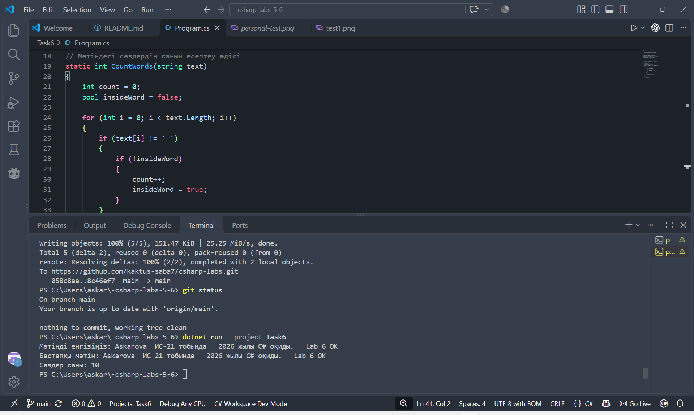

# Task6 — Символдар тіркесі

**Студент:** Аскарова Сарбар  
**Тізімдегі нөмір:** 2  
**Нұсқа:** 1

## 1. Тапсырманың мақсаты

Берілген мәтіндегі сөздердің санын есептейтін C# бағдарламасын құру.

Сөздер бір немесе бірнеше бос орын арқылы бөлінеді. Мәтіннің басында және соңында бос орындар болуы мүмкін.

## 2. Бағдарламаның жұмыс алгоритмі

1. Пайдаланушыдан мәтін `Console.ReadLine()` арқылы енгізіледі.
2. Егер мәтін бос болса, `do-while` циклі арқылы қайта енгізу сұралады.
3. Енгізілген бастапқы мәтін экранға шығарылады.
4. `CountWords()` әдісі шақырылады.
5. Мәтіндегі символдар `for` циклі арқылы біртіндеп тексеріледі.
6. Егер жаңа сөз басталса, сөз санауышы 1-ге артады.
7. Сөздердің жалпы саны экранға шығарылады.

## 3. Кодты түсіндіру

### 3.1. `text[i]` дегеніміз не және оның типі қандай?

`text[i]` — мәтіндегі индексі `i` болатын символды қайтарады.

Оның типі — `char`.

Мысалы, `text = "Hello"` болса:

- `text[0]` — H
- `text[1]` — e
- `text[2]` — l
- `text[3]` — l
- `text[4]` — o

### 3.2. C# тіліндегі `string` өзгермейтін тип пе?

Иә, `string` — өзгермейтін (immutable) тип.

Яғни құрылған мәтінді тікелей өзгертуге болмайды. Мәтінді өзгерту қажет болса, жаңа `string` объектісі құрылады.

### 3.3. Сөздің басталғанын қалай анықтаймыз?

Бағдарламада `insideWord` логикалық айнымалысы қолданылады.

- Егер символ бос орын болмаса және `insideWord == false` болса, жаңа сөз басталды деп есептеледі.
- Санауыш 1-ге артады.
- `insideWord = true` болады.
- Егер бос орын кездессе, `insideWord = false` болады.

Осы алгоритм бірнеше бос орынды, мәтіннің басындағы және соңындағы бос орындарды дұрыс өңдейді.

### 3.4. `do-while` циклі қалай жұмыс істейді?

`do-while` циклі алдымен командаларды орындайды, содан кейін шартты тексереді.

Бұл бағдарламада пайдаланушы бос мәтін енгізсе, мәтінді қайта енгізу сұралады.

## 4. Бағдарламаның нәтижесі

Бағдарламаның дұрыс жұмыс істеуін тексеру үшін үш тест орындалды.

### 4.1. Бірінші тест — жеке тест

**Енгізілген мәтін:**

`Askarova  ИС-21 тобында   2026 жылы C# оқиды.   Lab 6 ОК   `

Мәтіннің басында, ортасында және соңында бірнеше бос орын бар.

**Қолмен есептеу:**

1. Askarova
2. ИС-21
3. тобында
4. 2026
5. жылы
6. C#
7. оқиды.
8. Lab
9. 6
10. ОК

**Күтілетін нәтиже:** 10 сөз.

**Бағдарлама нәтижесі:**

```text
Мәтінді енгізіңіз: Askarova  ИС-21 тобында   2026 жылы C# оқиды.   Lab 6 ОК
Бастапқы мәтін: Askarova  ИС-21 тобында   2026 жылы C# оқиды.   Lab 6 ОК
Сөздер саны: 10
```

**Скриншот:**



### 4.2. Екінші тест — үш сөзден тұратын мәтін

**Енгізілген мәтін:**

`Hello my world`

**Қолмен есептеу:**

1. Hello
2. my
3. world

**Күтілетін нәтиже:** 3 сөз.

**Бағдарлама нәтижесі:**

```text
Мәтінді енгізіңіз: Hello my world
Бастапқы мәтін: Hello my world
Сөздер саны: 3
```

### 4.3. Үшінші тест — бір сөзден тұратын мәтін

**Енгізілген мәтін:**

`Programming`

**Қолмен есептеу:**

1. Programming

**Күтілетін нәтиже:** 1 сөз.

**Бағдарлама нәтижесі:**

```text
Мәтінді енгізіңіз: Programming
Бастапқы мәтін: Programming
Сөздер саны: 1
```

### 4.4. Тест нәтижелерінің кестесі

| Тест | Кіріс | Қолмен есептеген жауап | Бағдарлама жауабы |
|---|---|---:|---:|
| Жеке тест | `Askarova  ИС-21 тобында   2026 жылы C# оқиды.   Lab 6 ОК` | 10 | 10 |
| Өз тестім 1 | `Hello my world` | 3 | 3 |
| Өз тестім 2 | `Programming` | 1 | 1 |

**Қорытынды:** Үш тест те сәтті орындалды. Бағдарлама мәтіндегі сөздерді дұрыс санайды.

## 5. Сұрақтарға жауап

**1. `text[i]` нені қайтарады, типі қандай? Неге `text[i] = 'a';` деп жазуға болмайды?**

`text[i]` мәтіндегі индексі `i` болатын бір символды қайтарады. Оның типі — `char`. C# тіліндегі `string` өзгермейтін тип болғандықтан, оның жеке символын осылай тікелей өзгертуге болмайды.

**2. Жаңа сөздің басталғанын қалай анықтадыңыз? Жол бос орыннан басталса, программа қате санамай ма?**

`insideWord` айнымалысы арқылы жаңа сөздің басталғанын анықтадым. Егер символ бос орын болмаса және `insideWord` мәні `false` болса, сөз санауышы бірге артады. Жол бос орыннан басталса да, бағдарлама дұрыс санайды, себебі бос орындар сөз ретінде есептелмейді.

**3. `result += ch;` орындалғанда жаңа жол жасала ма, әлде ескісі өзгере ме?**

`string` өзгермейтін тип болғандықтан, `result += ch;` орындалғанда жаңа жол объектісі жасалады. Бұрынғы жол өзгермейді, айнымалы жаңа жолға сілтеме жасайды.

## 6. Кездескен қате

**Қате:** Бағдарламаны қайта құрастыру кезінде `MSB3027` және `MSB3021` қателері пайда болды. `Task6.exe` файлын басқа процесс қолданып тұрғандықтан, файлды көшіру мүмкін болмады.

**Қатенің себебі:** Бұрын іске қосылған Task6 бағдарламасының процестері жабылмай қалған.

**Қалай түзеттім:**

1. PowerShell терминалында іске қосылған процестердің PID нөмірлері анықталды.
2. `taskkill` командасы арқылы процестер тоқтатылды.
3. Бағдарлама қайта іске қосылды.
4. Бағдарлама қатесіз орындалды.

Қолданылған командалар:

```powershell
taskkill /PID 17916 /F
taskkill /PID 24864 /F
dotnet run --project Task6
```

**Нәтиже:** Қате жойылып, бағдарлама дұрыс іске қосылды.

**Түзеткен коммит:** Бұл қате жергілікті компьютердегі іске қосылған процестерге байланысты болғандықтан, оны түзету үшін код өзгертілген жоқ. Арнайы түзету коммиті жасалмады.

## 7. Git

### 7.1. `git log --oneline --graph --all` командасының нәтижесі

```text
* 8c46ef7 (HEAD -> main, origin/main) Complete Task6 README and personal test
*   058c8aa Merge pull request #5 from kaktus-saba7/task6
|\  
| * e3d6db6 (origin/task6, task6) Add Task6 personal test screenshot and documentation
| * b402c06 Complete Task6 tests and documentation
* |   f6949b1 Merge pull request #4 from kaktus-saba7/task5-test-results
|\ \  
| * | f0ea249 (origin/task5-test-results, task5-test-results) Add complete Task5 test results
|/ /  
* |   a14c69a Merge pull request #3 from kaktus-saba7/task5-corrections
|\ \  
| * | a080ee0 (origin/task5-corrections, task5-corrections) Update Task5 execution screenshot
| * | b8b730d Improve Task5 documentation
| * | 854be92 Fix main README table
| * | 732b8fd Add Task5 test cases and loop analysis
| * | c393f6a Update matrix random range
|/ /  
* | 73fd6cd Merge pull request #2 from kaktus-saba7/task6
|\| 
| * 554f324 Add Task6 execution screenshot
| * a89be36 Add Task6 documentation
| * eec8c06 Implement word counting algorithm
| * 6091644 Create Task6 project structure
|/  
*   4c2eb93 Merge pull request #1 from kaktus-saba7/task5
|\  
| * 553d026 (origin/task5, task5) Add Task5 execution screenshot
| * 1d75d53 Add Task5 documentation
| * e26a81c Implement matrix and column maximum calculation
| * d9e984b Create Task5 project structure
|/  
* 8218a6d Initial commit: add README and gitignore
```

### 7.2. Git сұрақтарына жауап

**1. task5 тармағында жасаған коммиттеріңіз main-ге қалай түсті? Біріктіруден кейін task5 тармағы не болды?**

`task5` тармағындағы өзгерістер GitHub-та Pull Request арқылы `main` тармағына біріктірілді. Біріктіру нәтижесінде барлық өзгерістер `main` тармағында сақталды. `task5` тармағы автоматты түрде жойылмайды, оны GitHub-та бөлек жоюға болады.

**2. commit пен push айырмашылығы неде? Push жасамасаңыз, мұғалім не көреді?**

`commit` өзгерістерді жергілікті компьютердегі Git тарихына сақтайды. `push` сол коммиттерді GitHub репозиторийіне жібереді. Push жасалмаса, мұғалім GitHub-тағы репозиторийден соңғы өзгерістерді көре алмайды.

**3. .gitignore файлына не жаздыңыз және bin/, obj/ неге репозиторийге қосылмайды?**

`.gitignore` файлына `bin/` және `obj/` сияқты уақытша құрастыру файлдарын қоспау ережелері жазылады. `bin/` ішінде құрастырылған бағдарламалар, ал `obj/` ішінде аралық файлдар сақталады. Олар қажет кезде қайта жасалатындықтан, репозиторийді артық файлдармен толтырмау үшін Git-ке қосылмайды.

## 8. ЖИ қолдану

Бұл тапсырманы орындау барысында ChatGPT қолданылды. ЖИ-ден C# бағдарламасының жұмыс алгоритмін, `CountWords()` әдісін, Git командаларын және README құрылымын түсіндіру сұралды. Ұсыныстар тексеріліп, бағдарлама компьютерде іске қосылды және тест нәтижелері тексерілді.